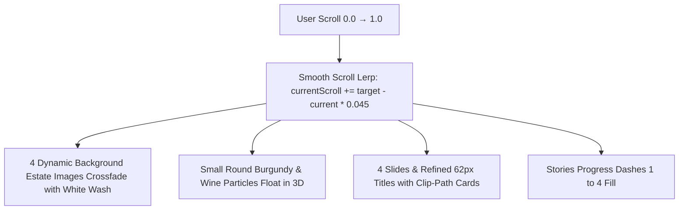

# Section 04: Bronze & Time Skyline Scroll Section (Pinned 3D WebGL)

**Component File**: `components/BronzeTimeScrollSection.tsx`  
**Page Integration**: `app/page.tsx` (Mounted between Section 03 Marquee Strip and Section 05 Featured Residences)  
**Parent Brand**: Velvet Key — Quiet Luxury Real Estate Dubai  

---

## 1. Overview & Architecture

`BronzeTimeScrollSection` is a cinematic, scroll-driven pinned WebGL section built in Next.js with Three.js. As visitors scroll down the page, this section pins into a full-screen sticky viewport while the page scrolls through a virtual `450vh` to `500vh` height. The scroll depth drives:
- **4 Dynamic Background Images**: As visitors scroll through the 4 milestones, the background smoothly crossfades between 4 dedicated full-bleed luxury architectural estate images (`/estate-slide-1.jpg` to `/estate-slide-4.jpg`).
- **Alabaster White Luminous Wash**: The background images are layered with a soft `#FBF8F3` alabaster white wash and horizontal/vertical gradients (`from-[#FBF8F3]/90 via-[#FBF8F3]/65 to-[#FBF8F3]/35`), preserving the clean, high-end white aesthetic while showing the estate photography.
- **Refined Title Typography Size**: Decreased headline font size from `104px` to a balanced, elegant `62px` (`text-3xl sm:text-5xl lg:text-[62px] leading-[1.05]`) for perfect editorial proportions.
- **Small Round Velvet Burgundy Particles**: 130 smooth, circular micro-particles in Velvet Burgundy (`#6D1A2B`) and Wine (`#9B2640`) rendered with radial canvas textures floating peacefully in 3D over the background.
- **Editorial Guidelines & Accents**: 5 vertical architectural guidelines with glowing burgundy dots (`vk-grid-dot`) and stories-style milestone progress bars with burgundy gradient fill (`from-[#6D1A2B] to-[#9B2640]`).
- **4 Story Slides & Dedicated Highlight Cards**: 4 luxury real estate images in framed editorial cards with per-letter blur-up typography.



---

## 2. Visual & Brand Color Theme

The stage and typography adhere strictly to Velvet Key's quiet luxury palette:

| Element | Color Palette | Values |
| :--- | :--- | :--- |
| **Stage Background** | Dynamic Estate Photography with Alabaster White Wash | 4 Slide Images + `#FBF8F3` luminous gradient veil |
| **Headline Typography** | Deep Velvet Charcoal (Decreased Size) | `text-3xl sm:text-5xl lg:text-[62px]`, `#161112` |
| **Small Round Particles (130 count)** | Velvet Burgundy & Wine Dots | `#6D1A2B` and `#9B2640` with smooth radial circle texture |
| **Grid Lines & Dots** | Champagne with Burgundy Dots | Line `#E8DCC8/50`, Dots `#6D1A2B` |
| **Descriptions** | Muted Slate in Dual Columns | `#4A4244`, max-w-sm |
| **Milestone Indicators** | Velvet Burgundy Gradient Fill | Track `#E8DCC8`, Fill `from-[#6D1A2B] to-[#9B2640]` |

---

## 3. The 4 Scroll Milestones & 4 Dedicated Real Estate Images

Each scroll milestone activates its dedicated background view and foreground editorial slide:

```
Scroll Range 0.00 – 0.25 | Milestone 01: The Palm Sanctuary
Background & Card: /estate-slide-1.jpg (Beachfront villa with infinity pool)
----------------------------------------------------------------------
Scroll Range 0.25 – 0.50 | Milestone 02: The Fairway Palace
Background & Card: /estate-slide-2.jpg (Emirates Hills modern mansion)
----------------------------------------------------------------------
Scroll Range 0.50 – 0.75 | Milestone 03: The Horizon Penthouse
Background & Card: /estate-slide-3.jpg (Downtown Dubai sky penthouse terrace)
----------------------------------------------------------------------
Scroll Range 0.75 – 1.00 | Milestone 04: The Island Sanctum
Background & Card: /estate-slide-4.jpg (Jumeirah Bay Island superyacht estate)
```

---

## 4. Overlap Prevention & Seamless Transitions

- **Edge Feathering**: The background layer includes a top/bottom vertical gradient fade (`from-[#FBF8F3] via-transparent to-[#FBF8F3]/80`), ensuring that the borders seamlessly blend to pure `#FBF8F3` with zero cutoffs.
- **Zero Layout Spill**: The slide image container is positioned `absolute` within `stickyRef` which enforces `overflow-hidden`. When the section unpins at 100% scroll, all milestone media scrolls away naturally with the container, completely preventing any overlap onto Section 05 (*Featured Residences*).
- **Hydration Safety**: Layout body includes `suppressHydrationWarning` to guard against browser extension attributes (`cz-shortcut-listen`, etc.).
