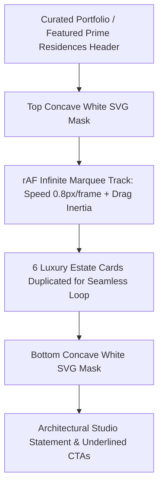

# Section 05: Curated Portfolio — Featured Prime Residences (Infinite Drag Marquee)

**Component File**: `components/FeaturedResidencesMarquee.tsx`  
**Page Integration**: `app/page.tsx` (Section 05: Mounted between Section 04 Bronze & Time Scroll Section and Section 06 Communities Gallery)  
**Parent Brand**: Velvet Key — Quiet Luxury Real Estate Dubai  

---

## 1. Overview & Architecture

The **Featured Prime Residences** section has been upgraded with the architecture studio horizontal marquee experience while preserving 100% of the user's curated property content, real Dubai specifications, pricing, and viewing consultation functionality.

---

## 2. Key Design & Interaction Features

### A. Curved White Masks (Top & Bottom)
- **Top Mask**:
  - Dimensions: `h-[80px] sm:h-[100px]`
  - SVG viewBox: `0 0 1440 100`, `preserveAspectRatio="none"`
  - Path: `M0 0H1440V50C1440 50 1200 100 720 100C240 100 0 50 0 50V0Z`
  - Effect: Soft concave white curtain dipping into the property cards strip from above.
- **Bottom Mask**:
  - Dimensions: `h-[80px] sm:h-[100px]`
  - SVG viewBox: `0 0 1440 100`, `preserveAspectRatio="none"`
  - Path: `M0 100H1440V50C1440 50 1200 0 720 0C240 0 0 50 0 50V100Z`
  - Effect: Symmetrical inverted white curtain framing the bottom of the strip.

### B. RequestAnimationFrame Drag & Inertia Engine
- **Auto-scroll**: Constant `SPEED = 0.8px` per frame crawl to the left.
- **Drag Interaction**:
  - `onPointerDown`: captures pointer with `setPointerCapture`, switches to `cursor-grabbing`.
  - `onPointerMove`: calculates velocity normalized to ~60fps (`(dx / dt) * 16`).
  - `onPointerUp`: releases pointer capture, allows velocity to coast with `0.95` momentum decay until `|velocity| <= 0.1`, then seamlessly resumes auto-scroll.
- **Seamless Wrap**: Array duplicated once (`[...properties, ...properties]`). Wraps smoothly when `offset <= -halfWidth` or `offset > 0`.

### C. Property Content & Cards
- Card size: `w-64 h-88 sm:w-80 sm:h-[32rem] flex-shrink-0 rounded-2xl overflow-hidden`.
- Exact architectural imagery from Higgs CDN with CloudFront and local high-res fallbacks.
- Complete user property data preserved:
  1. *The Frond Horizon Signature Villa* (Palm Jumeirah · Frond N, AED 68M)
  2. *The Palm Crown Sky Penthouse* (Palm Jumeirah · Crescent, AED 84M)
  3. *The Montgomerie Fairway Estate* (Emirates Hills · Sector E, AED 115M)
  4. *Bulgari Private Marina Duplex* (Jumeirah Bay Island, AED 62M)
  5. *The Opera District Sky Villa* (Downtown Dubai · Opera District, AED 46M)
  6. *Dubai Hills Grove Fairway Residence* (Dubai Hills Estate, AED 58M)
- Includes status badges, bedroom/bath/sqft counts, offered prices in AED, "Details →" links, and viewing modal consultation button (`📅`).

### D. Architectural Studio Statement & CTAs
- Body copy:
  *“We design private residences and commercial spaces from a blank page. No templates, no repeated floorplans, no shortcuts.”*
- Two underlined text links:
  - *“Book a meeting”* (triggers viewing modal consultation)
  - *“See Projects”* (links to `/properties`)
  - Styled with `underline underline-offset-4 decoration-neutral-400 hover:decoration-neutral-900 transition-colors`.

### E. Typography
- Google Font **Geist** loaded via Google Fonts CDN in `app/layout.tsx` and configured in `app/globals.css`.
